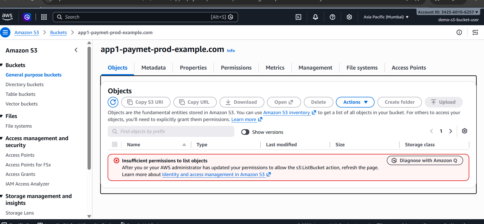

## Demo 1: AWS IAM User Permissions vs S3 Bucket Policy

### Project Overview
This demo explains how an Amazon S3 bucket policy can override permissions granted through an IAM identity policy.

### Implementation Steps
1. Created an IAM user with permissions to access Amazon S3.
2. Verified the IAM user's S3 access.
3. Logged in to the AWS root account and updated the S3 bucket policy.
4. Added an explicit `Deny` statement to restrict S3 actions for principals other than the specified root principal.
5. Logged in as the IAM user and tested bucket access again.
6. Verified that the IAM user's access was denied despite the permissions granted through IAM.

### Key Learning
- IAM identity policies control the permissions granted to IAM users and roles.
- S3 bucket policies control access to bucket resources.
- An explicit `Deny` overrides an applicable `Allow` permission.
- AWS evaluates applicable identity-based and resource-based policies when determining access.

### Technologies Used
- AWS IAM
- Amazon S3
- JSON Bucket Policy
- AWS Management Console

### Screenshots
Add screenshots showing:
- IAM user permissions
- S3 bucket policy with the explicit `Deny`
- The IAM user's access-denied result

### Security Note
The root account should be used only for tasks that specifically require it. For routine administration, use an appropriately permissioned IAM role or administrative identity. Never upload AWS credentials or secrets to GitHub.

### Access Denied Result

